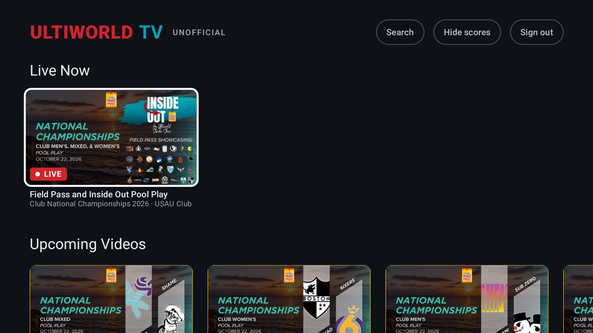

# Ultiworld TV

An Android TV / Google TV app for watching [Ultiworld](https://ultiworld.com) with a remote: live games,
replays, event and team packs, search, and today's scores. It uses your own Ultiworld subscription.



Unofficial: not made by, endorsed by or affiliated with Ultiworld. You need your own Ultiworld account, and
the app only plays what that account can already watch on the website, within the site's device limit.
Ultiworld is a trademark of its owners and is used here only to say what the app is for. If you work at
Ultiworld and want something changed, open an issue.

## Features

- **Home**: the video library's rows, plus today's games in progress, coming up and finished, with scores.
- **Search** by team, player or event, also from the remote's search key.
- **Hide scores**: a spoiler switch at the top of Home.
- **Player**: full screen, with play/pause and seeking on the remote. Live games can be rewound.
- **Log in from your phone**: scan the QR code on the TV and type your login there instead of with the remote.
  Your phone has to be on the same Wi-Fi.

## Install on the TV

It runs on Android TV and Google TV 8.0 or newer. Some TVs from cable companies, hotels or workplaces don't
allow apps from outside their store, and on those it can't be installed.

1. On the TV, install **Downloader** by AFTVnews from the Play Store.
2. Open it, type this code into its box and choose **Go**:

   ```
   2714454
   ```

   If the code doesn't work, type the full address instead:

   ```
   https://github.com/MyronL/ultiworld-tv/releases/latest/download/ultiworld-tv.apk
   ```

3. When it has downloaded, choose **Install**. The first time, the TV asks you to let Downloader install
   apps: turn that on and go back. If your TV doesn't offer it (some Google TVs hide it), turn on developer
   options first: open **Settings → System → About** and press OK on **Android TV OS build** seven times,
   then try again. If Google Play Protect warns that it doesn't know the app, choose to install anyway.
4. Open Ultiworld TV from your apps and log in once with your Ultiworld account. Type it with the remote, or
   scan the QR code with a phone on the same Wi-Fi and type it there.

When there's a new version, an **Update** button appears at the top of Home. Press it and confirm on the TV.
The first time, the TV asks you to let Ultiworld TV install apps, as it did for Downloader. The app closes to
update; open it again and you're still logged in.

To log out, use **Sign out** at the top of Home. To remove the app: **Settings → Apps → Ultiworld TV →
Uninstall**.

To build it yourself and install it from a computer instead, see [docs/building.md](docs/building.md).

## What it does and doesn't do

- **Plays only what your plan includes.** It doesn't get around Ultiworld's paywall.
- **Counts as one of your devices**, like the website, and stops if Ultiworld says you're watching on too many.
- **Doesn't store your password.** It keeps you logged in the way a browser does.
- **Encrypts a login sent from your phone**, with a one-time key in the QR code, before it crosses your Wi-Fi.
- **Checks GitHub for updates** every few hours, and downloads one only when you press **Update**.

## Contributing

Pull requests are welcome, especially ones that keep the app working when Ultiworld changes its site. Before
opening one, run the same checks as CI:

```bash
./gradlew ktlintFormat testDebugUnitTest lintDebug
```

For bigger changes, open an issue first. The app stays a viewer for people's own subscriptions: changes that
get around the paywall, the device limit or anything else Ultiworld enforces won't be merged.

Publishing a release is in [docs/releasing.md](docs/releasing.md).

## License

[MIT](LICENSE). Built with [Jetpack Compose for TV](https://developer.android.com/jetpack/androidx/releases/tv),
[Media3 ExoPlayer](https://developer.android.com/media/media3), [Coil](https://coil-kt.github.io/coil/) and
[ZXing](https://github.com/zxing/zxing), all under the Apache License 2.0.
